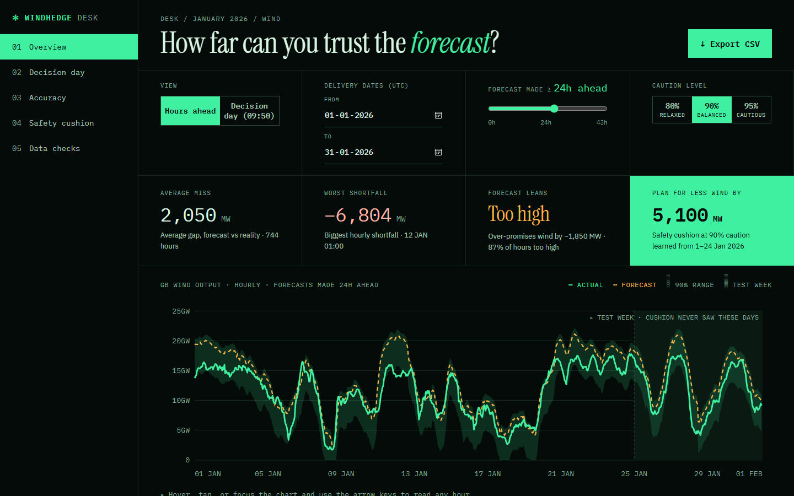

# Windhedge

*Don’t guess the gust, buy what you must.*

[](https://github.com/Adithya6ramesh/yuyi/actions/workflows/ci.yml)

A UK energy company buys electricity on the **day-ahead market**, so orders for tomorrow
go in today. Windhedge shows the national wind forecast that was **really available when
each order was due**, measures how wrong those forecasts were in January 2026, and says
how much **safety margin** to plan for. It uses public Elexon data (FUELHH actuals,
WINDFOR forecasts). It doesn't build a prediction model: it displays and evaluates the
forecasts that already exist.



**Live demo:** <https://windhedge.vercel.app> (the desk: <https://windhedge.vercel.app/desk>)


## Architecture


## Quick start

### With Docker (easiest)

You need [Docker Desktop](https://www.docker.com/products/docker-desktop/), running.

```powershell
docker compose up --build
```

Open <http://localhost:8080>.
- `/` is the landing page.
- `/desk` is the dashboard.
- `/docs` is the API's interactive "Try it out" page.

Stop it with **Ctrl + C**.

### Without Docker (for development)

You need Python 3.12 (what Vercel, Docker and CI use; 3.11 also works) and Node 22. Use two terminals:

```powershell
# terminal 1: the API, on http://127.0.0.1:8000
cd backend
python -m venv .venv                                            # first time only
.venv\Scripts\python.exe -m pip install -r requirements-dev.txt # first time only
.venv\Scripts\python.exe -m uvicorn app.main:app --reload

# terminal 2: the website, on http://localhost:5173
cd frontend
npm install                                                     # first time only
npm run dev
```

Open <http://localhost:5173>. Vite's proxy passes `/api/...` to the backend.

### Settings

| Setting | Where | What it does |
|---|---|---|
| `VITE_API_URL` | frontend (`.env`, see `frontend/.env.example`) | The backend's address once deployed. Leave it empty in development and in Docker. |
| `ALLOWED_ORIGINS` | backend environment | The web addresses allowed to call the API (comma-separated). Default `http://localhost:5173`. |

## Docker and deployment

The whole app is containerised: `docker compose up --build` runs the frontend (nginx) and
the API (FastAPI) with no other setup, and CI builds and starts both images on every
push. For hosting I chose Vercel, one of the two platforms in the brief. Vercel can also
run Docker images, but that feature (Container Runtime) is still in beta, so the live site
uses Vercel's generally available FastAPI support instead: one serverless function runs the
same API code, and the built React app is served from Vercel's CDN on the same address.
Heroku would run the container directly, but has no free plan. How the deployment is set
up: [DESIGN.md §8](docs/DESIGN.md#8-docker-and-deployment).

## Documentation

- **[docs/DESIGN.md](docs/DESIGN.md):** how it's built and why. Architecture, data, the
  matching rule, metrics and cushion, API, frontend, Docker, testing, decisions and
  limitations.
- **[docs/FINDINGS.md](docs/FINDINGS.md):** what the data showed, in plain English. The
  forecast leans too high, when it's worst, how big a cushion to plan for, and whether
  that cushion held up.
- **API reference:** the automatic `/docs` page (e.g. <http://localhost:8080/docs>).

## Tests and code quality

| | Backend (`cd backend`) | Frontend (`cd frontend`) |
|---|---|---|
| Tests | `.venv\Scripts\python.exe -m pytest` | `npm test` |
| Lint | `.venv\Scripts\python.exe -m ruff check .` | `npm run lint` |
| Format check | `.venv\Scripts\python.exe -m ruff format --check .` | `npm run format:check` |
| Auto-format | `.venv\Scripts\python.exe -m ruff format .` | `npm run format` |
| Tests inside Docker | `docker compose --profile test run --rm backend-tests` (from the project folder) | |

CI ([.github/workflows/ci.yml](.github/workflows/ci.yml)) runs all of these on every push,
then builds and starts both Docker images and checks the app answers on port 8080.

## AI tools used

Built with **Claude** (Anthropic's AI assistant, through Claude Code). It worked phase by
phase, plan first and only after my approval, with tests on the tricky logic. The visual
design was also made with AI assistance. Details: [DESIGN.md §12, "How AI tools were
used"](docs/DESIGN.md#12-how-ai-tools-were-used).

## Project layout

```
backend/    FastAPI app (app/), tests, processed January data, Dockerfile
frontend/   React + Vite app (src/), design mockups, Dockerfile, nginx config
docs/       DESIGN.md, FINDINGS.md, screenshots/
docker-compose.yml   runs both together
```
